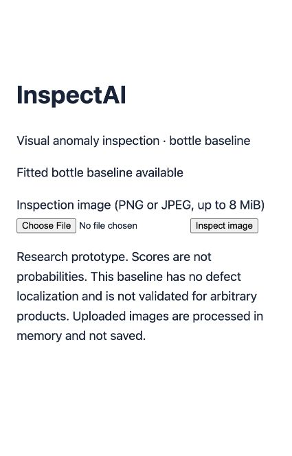
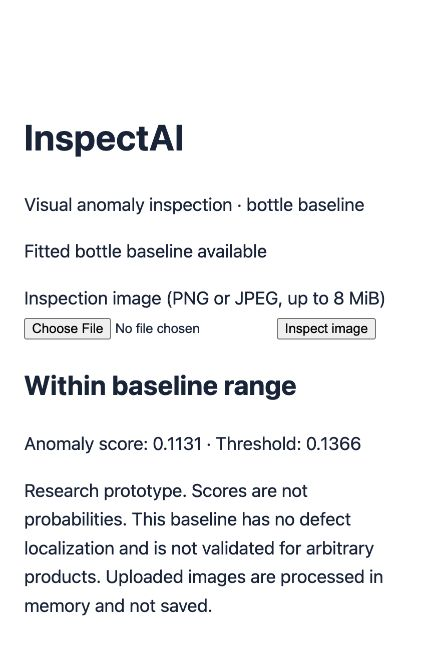
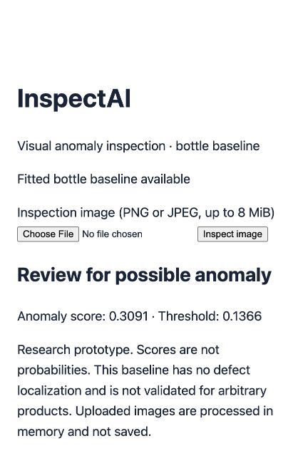

# InspectAI walkthrough

A text-and-screenshot demo of the original bottle baseline, followed by an optional local patch experiment. Captures were taken from the running Docker app on localhost port 8101. No narration or video is required.

## 1. Open the upload page

Follow [Docker setup](DOCKER.md), then open http://127.0.0.1:8101/. Confirm “Fitted bottle baseline available.” Choose a local PNG or JPEG and click **Inspect image**. No customer account is needed for this localhost research demo.



The application loads the fitted reference bank and frozen pretrained features. It does not train a new model on the uploaded image. Files are processed in memory and not saved.

## 2. Inspect a normal test example

Choose `data/mvtec/bottle/test/good/000.png` and click **Inspect image**.



The measured score is **0.1131**, below the **0.1366** threshold, so the result says **Within baseline range**. This does not certify defect-free products. The screenshot contains the actual response, not a simulated UI.

## 3. Inspect a defective test example

Choose `data/mvtec/bottle/test/broken_large/000.png` and click **Inspect image**.



The score is **0.3091**, above the same threshold, so the result says **Review for possible anomaly**. The score is a feature distance, not a probability or defect-type diagnosis. The global baseline does not generate heatmaps.

These examples illustrate the UI; they are not the full evaluation. Across all 83 test images the original method detected 61/63 defects and flagged 1/20 normal images. See [results](RESULTS.md), [raw scores](reports/evaluation-20261023T042247Z.json), and [failure analysis](ERROR_ANALYSIS.md).

## 4. Explore the separate patch experiment locally

From the project directory:

```sh
.venv/bin/python -m inspectai.patches --dataset data/mvtec/bottle
open artifacts/patch-review.html
```

The local page pairs the center-cropped model input with its experimental spatial anomaly map. Red means a higher relative score within that image, blue lower. Color scaling is independent for each image; it is not a probability or a comparison of confidence across images. Localization accuracy has not been established.

A reviewed local screenshot is saved at `artifacts/04-heatmap-local.png` on the development machine. It is deliberately excluded from Git along with the generated HTML because they embed dataset images. Readers can generate their own local report after obtaining the dataset under its terms. Public screenshots above show app controls and numeric results without dataset pixels.

The patch method detected 58/63 defects with no false alarms at its separately calibrated threshold. It missed more defects than the original method, so it did not replace the upload baseline. Read the [experiment report](PATCH_EXPERIMENT.md) for the full tradeoff.

## What this demonstrates

The project separates normal reference fitting, normal-only threshold calibration, and test evaluation; compares alternatives; records errors rather than hiding them; and packages a bounded local app with CI. It does not demonstrate production factory validation, a commercially licensed dataset, public hosting, or reliable arbitrary-product inspection.

## Capture provenance

The three public PNG screenshots are unedited browser captures of actual Docker responses. Example paths and scores match [container smoke-check evidence](reports/container-smoke.json). The heatmap screenshot is a separate local experiment, not a feature of the upload endpoint. Dataset and model provenance are documented in [DATASET.md](DATASET.md).
